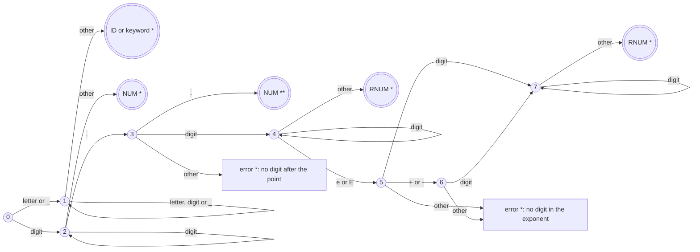
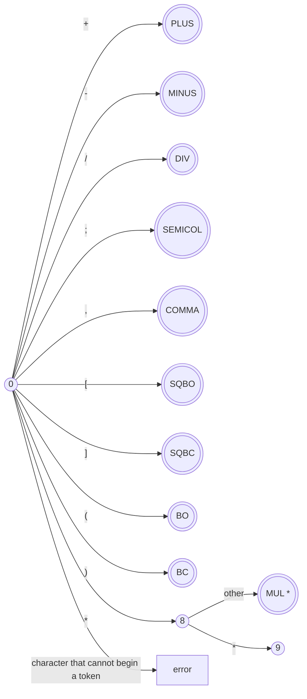
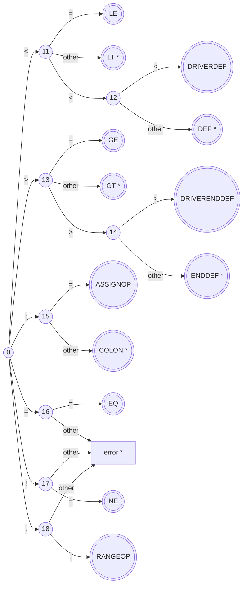
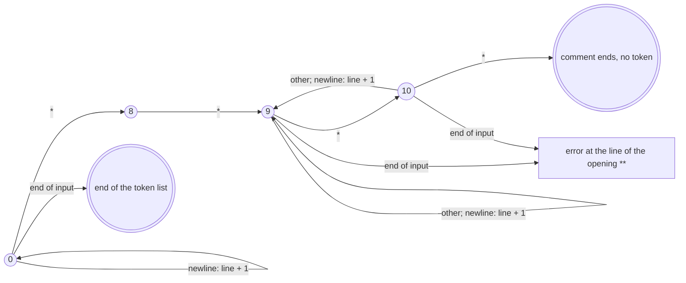

# DFA of the ERPLAG Lexer

One DFA recognizes every token. Its four parts below share the start state 0.

- `((n))` is state *n*; `(((T)))` is an accepting state that returns the token *T*.
- `*` on an accepting or error state: the last character read is not part of the token and is read again; `**`: the last two characters.
- *other*: any character without an arrow of its own, including the end of the input.
- *error*: the text read is reported as a lexical error with its line number, and scanning continues in state 0.

## Identifiers, keywords and numbers

Action at *ID or keyword*: a word longer than 20 characters is a lexical error; any other word is looked up in the keyword table below. Action at *NUM* and *RNUM*: an integer above 9223372036854775807 or a real number above the largest double is a lexical error. `NUM **` is an integer followed by the range operator, as in `1..10`.

## Operators and punctuation

State 9, the inside of a comment, is in the last diagram.

## Relational, assignment, range and delimiter operators

## Comments and white space

## Keyword lookup table

The 30 keywords are kept in a hash table of 61 slots, filled when the lexer is opened. The hash of a word is `h = 31 × h + c` over its characters, modulo 61, and a collision moves on to the next free slot. The lookup compares whole words, so it is case sensitive: `Switch` is an identifier.

The DFA does not depend on the twin buffer through which the lexer reads its input.

| Keyword | Token | Keyword | Token | Keyword | Token |
|---|---|---|---|---|---|
| `integer` | INTEGER | `get_value` | GET_VALUE | `switch` | SWITCH |
| `real` | REAL | `print` | PRINT | `case` | CASE |
| `boolean` | BOOLEAN | `use` | USE | `break` | BREAK |
| `of` | OF | `with` | WITH | `default` | DEFAULT |
| `array` | ARRAY | `parameters` | PARAMETERS | `while` | WHILE |
| `start` | START | `takes` | TAKES | `true` | TRUE |
| `end` | END | `input` | INPUT | `false` | FALSE |
| `declare` | DECLARE | `returns` | RETURNS | `AND` | AND |
| `module` | MODULE | `for` | FOR | `OR` | OR |
| `driver` | DRIVER | `in` | IN | | |
| `program` | PROGRAM | | | | |
